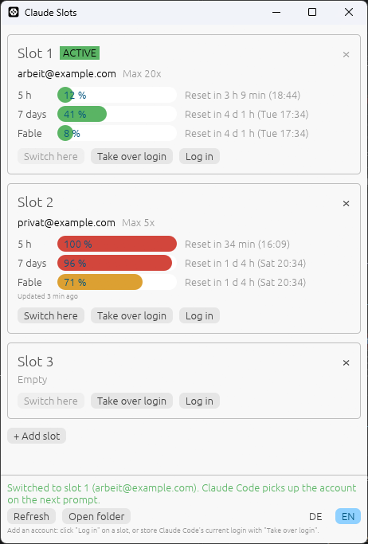
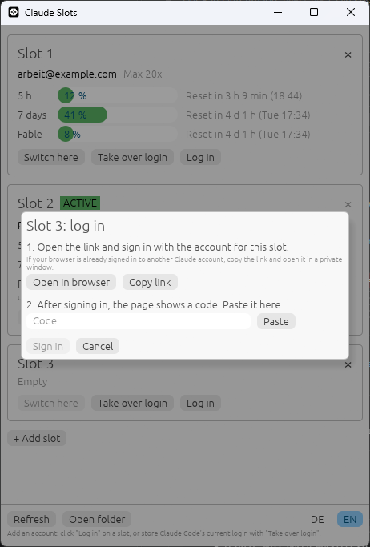

# Claude Slots

Switch Claude Code between several accounts with one click, and see how much
of each account's usage limit is left. A slot can also hold your own
Anthropic-compatible endpoint, e.g. a model you run on Runpod. Runs on Windows
and macOS.

Made for people who run out of one plan and keep another account to continue
working. No logging out, no browser login, no restart of Claude Code.



> The screenshots use made-up example accounts.

## Features

- **Account slots**, one click to make a slot the active Claude Code login.
  Add slots with **+ Add slot** (up to 10), remove them with **×**
- **Usage per account**: 5-hour window, 7-day window and per-model weekly
  limits (e.g. Fable), with reset countdowns
- **Endpoint slots**: point Claude Code at your own Anthropic-compatible
  server (llama.cpp, a gateway, a model on Runpod) and back to your Claude
  account with one click (see [Endpoint slots](#endpoint-slots))
- **English and German**, switch with **DE / EN** at the bottom right
- **Works while Claude Code is running** (CLI and VS Code extension): the new
  account is picked up on the next prompt
- **Log in per slot** without logging Claude Code out. Every login is
  independent, so the same account can run on several PCs at the same time
- **Never loses a login**: refuses to overwrite a login that is not stored in a
  slot, keeps a safety copy before every switch
- **Single portable .exe** (~7.5 MB) on Windows, a small **.app** on macOS,
  no installer, no runtime

## Download

From the [latest release](https://github.com/mashen456/claude-account-switcher/releases/latest):

- **Windows**: `claude-slots.exe`, just run it. SmartScreen may warn because
  the file is not code-signed: click *More info* → *Run anyway*.
- **macOS** (Apple Silicon and Intel, macOS 11 or newer): unzip
  `claude-slots-macos.zip` and move **Claude Slots** to *Applications*. The app
  is not notarized, so the first start needs a right-click on the app → *Open*
  → *Open*. If macOS still says the app is damaged, run
  `xattr -dr com.apple.quarantine "/Applications/Claude Slots.app"` once.

## Setup (once)

1. Make sure Claude Code is logged in with your **first** account.
   Click **Take over login** on **Slot 1**.
2. Click **Log in** on **Slot 2** and sign in with your **second** account
   (see [Logging in to a slot](#logging-in-to-a-slot)).
3. More accounts: **+ Add slot**, then **Log in** on the new slot.

Alternatively, run `/login` in Claude Code for another account and click
**Take over login** on a slot. **Do not use `/logout`**: it revokes the token
of the account you are leaving.

## Usage

| Button | What it does |
|---|---|
| **Switch here** | Switch Claude Code to this slot |
| **Take over login** | Store the account Claude Code is currently logged in with in this slot |
| **Log in** | Log in to an account for this slot, independent of Claude Code |
| **×** | Remove the slot (asks first if it holds a login). The active slot and the last slot cannot be removed; the following slots move up |
| **Set up endpoint** / **Edit** | Store your own endpoint in an empty slot, or change it |
| **+ Add slot** | Append an empty slot (up to 10) |
| **Refresh** | Query usage now (at most every 3 minutes per account) |
| **Open folder** | Open the folder where the slots are stored |
| **DE / EN** | Switch the language. On first start it follows the system language |

**Usage display.** The usage endpoint allows only about 30 requests per hour
per account, and a burst can lock an account out for up to an hour. Claude
Slots therefore queries the active account at most every 5 minutes, inactive
accounts every 15 minutes, and never more often than every 3 minutes, not even
with **Refresh**. After a "too many requests" answer it pauses for the time the
server asks for plus 15 minutes. These times are stored in `usage-cache.json`,
so restarts and several open windows share one schedule.

An inactive account's access token expires after a few hours; from then on the
window shows the last known values and the reset time. Once a reset has passed,
the bar turns grey.

### Logging in to a slot



1. Click **Log in** on a slot.
2. Click **Open in browser** and sign in with the account for this slot. If
   your browser is already signed in to another Claude account, click
   **Copy link** and open the link in a private window instead.
3. After signing in, the page shows a code. Paste it into the window
   (**Paste** or Ctrl+V) and click **Sign in**.

This uses the same sign-in as Claude Code's own `/login`, but Claude Code
stays logged in as it is. If the account you log in with is the one Claude
Code is currently using, Claude Code switches to the new login as well.

**Using one account on several PCs.** Log in separately on every PC (with
**Log in** or `/login`). Each login has its own refresh token, so the
PCs never get in each other's way. Do not copy a slot file to another PC: a
refresh token can only be used once, so the first refresh on one PC would
invalidate the copy on the other.

### Endpoint slots

An endpoint slot makes Claude Code talk to your own server instead of
Anthropic, for example Qwen3-Coder running with llama.cpp on a Runpod
load-balancing endpoint. The server must speak the Anthropic Messages API
(`/v1/messages`); llama.cpp's `llama-server` does.

1. Click **Set up endpoint** on an empty slot (add one with **+ Add slot**).
2. Fill in
   - **Address**: the base URL without `/v1`, for Runpod
     `https://<ENDPOINT_ID>.api.runpod.ai`
   - **Token**: sent as `Authorization: Bearer …`, for Runpod your Runpod API key
   - **Model**: the model name the server expects (llama.cpp: its `--alias`)
3. Click **Switch here**, then **restart Claude Code**. Claude Code reads these
   settings only at startup.

Switching to an endpoint writes these variables to the `env` block of
`~/.claude/settings.json`:

| Variable | Value |
|---|---|
| `ANTHROPIC_BASE_URL` | Address |
| `ANTHROPIC_AUTH_TOKEN` | Token |
| `ANTHROPIC_MODEL`, `ANTHROPIC_DEFAULT_OPUS_MODEL`, `ANTHROPIC_DEFAULT_SONNET_MODEL`, `ANTHROPIC_DEFAULT_HAIKU_MODEL` | Model, so subagents and background tasks use it too |

`ANTHROPIC_AUTH_TOKEN` takes precedence over the claude.ai login, so the
login stays where it is and is not touched. **Switch here** on an account slot
removes the variables again and restores any values they had before (kept in
`endpoint-backup.json` meanwhile); other settings and other variables in `env`
stay as they are. Restart Claude Code after switching back as well.

Notes:

- No usage bars for endpoints, the usage display only exists for Claude
  accounts.
- A scale-to-zero endpoint (Runpod serverless with 0 minimum workers) needs a
  few minutes for the first request after a pause. Send one request (or open
  the endpoint's `/ping` with your API key) before you start working.
- An active endpoint cannot be removed or overwritten; switch to another slot
  first.
- Features that need a claude.ai login (claude.ai connectors, `/schedule`)
  are not available while an endpoint is active.

## How it works

A slot is a copy of what Claude Code stores after `/login`:

| What | Windows | macOS |
|---|---|---|
| Token | `%USERPROFILE%\.claude\.credentials.json` | Keychain item `Claude Code-credentials` (fallback: `~/.claude/.credentials.json`) |
| Account | `oauthAccount` block in `%USERPROFILE%\.claude.json` | `oauthAccount` block in `~/.claude.json` |

When switching, Claude Slots:

1. Takes the same lock directories Claude Code uses for its token refresh
   (`.oauth_refresh.lock`, `~/.claude.lock`, `~/.claude.json.lock`), so a
   running Claude Code cannot write back a refreshed token mid-switch.
2. **Writes the current token back into the outgoing account's slot.** Claude
   Code rotates the refresh token regularly and each one works only once.
   Without this step the slot would hold a used-up token.
3. Writes the target slot's token to `.credentials.json` (macOS: to the
   Keychain via `/usr/bin/security`, the same way Claude Code does, plus the
   fallback file if it exists). MCP and plugin logins
   (`mcpOAuth` etc.) keep their current state.
4. Replaces only `oauthAccount` in `.claude.json`. Projects, MCP servers and
   settings stay untouched.

Safety rules:

- If the current login is not stored in any slot, switching is refused (the
  login would be lost). Take it over into a slot first.
- A login whose tokens were cleared (Claude Code does that when a refresh is
  rejected) or that lacks a refresh token never overwrites a slot.
- Before every switch, the previous login is copied to `last-live.json`.
- Claude Slots never refreshes a token itself, so it cannot use one up.

**Log in** runs the OAuth flow Claude Code uses for `/login` (PKCE, with
the code shown on Anthropic's callback page), using Claude Code's public client
ID, endpoints and scopes as of Claude Code 2.1.300. It then reads the account
profile and stores token and account in exactly the format Claude Code writes.

## Files

Folder: `%LOCALAPPDATA%\claude-slots` on Windows,
`~/Library/Application Support/claude-slots` on macOS

| File | Content |
|---|---|
| `slot1.json`, `slot2.json`, … | Token and account of each slot |
| `settings.json` | Number of slots and language |
| `usage-cache.json` | Last known usage and query schedule per account |
| `last-live.json` | Safety copy taken before the last switch |
| `endpoint-backup.json` | Previous `env` values while an endpoint is active |

Tokens (and endpoint tokens) are stored in plain text, just like Claude Code's
own `.credentials.json` on Windows. The files are readable only by your user on
macOS.

## Command line

```
claude-slots --status         show slots and the current login
claude-slots --capture N      store the current login in slot N
claude-slots --switch N       switch to slot N
claude-slots --login N        log in (prints the link, reads the code) and store in slot N
claude-slots --endpoint N URL MODEL [NAME]
                              store an endpoint in slot N; the token comes from
                              CLAUDE_SLOTS_ENDPOINT_TOKEN or is asked for
claude-slots --add-slot       append an empty slot
claude-slots --remove-slot N  remove slot N
claude-slots --lang de|en     set the language
claude-slots --usage          query usage of the current login
```

On Windows the release build has no console window, so text only shows up when
output is redirected (`claude-slots --status | more`). On macOS call the binary
inside the app:
`"/Applications/Claude Slots.app/Contents/MacOS/claude-slots" --status`.
Exit codes (0 = ok, 1 = error) always work, which makes it easy to bind
`--switch` to a hotkey.

## Building from source

Requires [Rust](https://rustup.rs/) 1.85 or newer.

```
cargo build --release
```

On Windows the binary ends up in `target\release\claude-slots.exe`. On a Mac,
`scripts/macos-app.sh` builds a universal `Claude Slots.app` and a zip of it in
`target/macos/` (needs the Xcode Command Line Tools). The GitHub workflow in
`.github/workflows/build.yml` builds both and attaches them to a release when
a `v*` tag is pushed.

For testing without touching your real login, point these variables at
scratch folders:

| Variable | Effect |
|---|---|
| `CLAUDE_CONFIG_DIR` | Claude Code's config folder (also honoured by Claude Code itself; on macOS the Keychain item then gets a suffix derived from the path) |
| `CLAUDE_SLOTS_DIR` | Where slots are stored |
| `CLAUDE_SLOTS_NO_FETCH=1` | Don't query the usage API |

## macOS notes

- The token lives in the Keychain. The first time Claude Slots reads it, macOS
  may ask whether `security` may access the item: click **Always Allow**.
- After a switch, a running Claude Code may keep the previous account until
  its next token refresh or a restart. If it does, restart it.
- The Keychain item name used with `CLAUDE_CONFIG_DIR` (`Claude
  Code-credentials-` plus the first 8 hex characters of the SHA-256 of the
  folder path) follows other tools that read the same item and has not been
  verified against Claude Code yet.

## Disclaimer

This is an unofficial tool, not affiliated with or endorsed by Anthropic. It
relies on Claude Code's local file layout, its sign-in parameters and an
undocumented usage endpoint, all of which may change at any time. Check that
your use complies with Anthropic's terms. Use at your own risk.

## License

[MIT](LICENSE)
