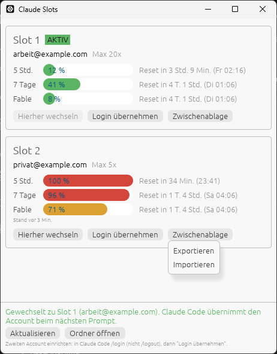

# Claude Slots

Switch Claude Code between two accounts with one click, and see how much of
each account's usage limit is left.

Made for people who run out of one plan and keep a second account to continue
working. No logging out, no browser login, no restart of Claude Code.


> The interface is currently in German. The screenshots use made-up example
> accounts.

## Features

- **Two account slots**, one click to make a slot the active Claude Code login
- **Usage per account**: 5-hour window, 7-day window and per-model weekly
  limits (e.g. Fable), with reset countdowns
- **Works while Claude Code is running** (CLI and VS Code extension): the new
  account is picked up on the next prompt
- **Never loses a login**: refuses to overwrite a login that is not stored in a
  slot, keeps a safety copy before every switch
- **Export / import a slot via the clipboard**, e.g. to move an account to
  another machine
- **Single portable .exe** (~7.5 MB), no installer, no runtime

## Download

Grab `claude-slots.exe` from the
[latest release](https://github.com/mashen456/claude-account-switcher/releases/latest)
and run it. Windows SmartScreen may warn because the file is not code-signed:
click *More info* → *Run anyway*.

## Setup (once)

1. Make sure Claude Code is logged in with your **first** account.
   Click **Login übernehmen** ("take over login") on **Slot 1**.
2. In Claude Code, run `/login` and sign in with your **second** account.
   **Do not use `/logout`**: it revokes the token of the first account.
3. Click **Login übernehmen** on **Slot 2**.

## Usage

| Button | What it does |
|---|---|
| **Hierher wechseln** | Switch Claude Code to this slot |
| **Login übernehmen** | Store the account Claude Code is currently logged in with in this slot |
| **Zwischenablage → Exportieren** | Copy this slot's login to the clipboard |
| **Zwischenablage → Importieren** | Put an exported login into this slot |
| **Aktualisieren** | Refresh usage now (at most every 20 s) |
| **Ordner öffnen** | Open the folder where the slots are stored |

**Usage display.** Usage is refreshed every 5 minutes. The active account is
always live. The inactive account's access token expires after a few hours;
from then on the window shows the last known values and the reset time. Once a
reset has passed, the bar turns grey.

### Moving an account via the clipboard



**Exportieren** copies the slot as a single line of text
(`claude-slot:v1:…`). For the active slot, Claude Code's current token is taken
first, so you never export an already used token. MCP and plugin logins stay on
the machine.

**Importieren** reads such a line from the clipboard. If the slot holds a
different account, you are asked first. The clipboard is cleared after a
successful import. Line breaks added by chat apps are ignored.

On Windows the exported text is excluded from clipboard history (Win+V) and
cloud clipboard sync. It still contains the token: only share it over a
channel you trust.

> **A refresh token can only be used once.** If the same account is used on
> two machines, the first token refresh on one machine invalidates the token on
> the other. After moving an account, use it on one machine only.

## How it works

A slot is a copy of what Claude Code stores after `/login`:

| What | Where |
|---|---|
| Token | `%USERPROFILE%\.claude\.credentials.json` |
| Account | `oauthAccount` block in `%USERPROFILE%\.claude.json` |

When switching, Claude Slots:

1. Takes the same lock directories Claude Code uses for its token refresh
   (`.oauth_refresh.lock`, `~/.claude.lock`, `~/.claude.json.lock`), so a
   running Claude Code cannot write back a refreshed token mid-switch.
2. **Writes the current token back into the outgoing account's slot.** Claude
   Code rotates the refresh token regularly and each one works only once.
   Without this step the slot would hold a used-up token.
3. Writes the target slot's token to `.credentials.json`. MCP and plugin logins
   (`mcpOAuth` etc.) keep their current state.
4. Replaces only `oauthAccount` in `.claude.json`. Projects, MCP servers and
   settings stay untouched.

Safety rules:

- If the current login is not stored in any slot, switching is refused (the
  login would be lost). Take it over into a slot first.
- A login whose tokens were cleared (Claude Code does that when a refresh is
  rejected) or that lacks a refresh token never overwrites a slot.
- Before every switch, the previous login is copied to `last-live.json`.
- Claude Slots never refreshes a token itself, so it cannot use one up.

## Files

Folder: `%LOCALAPPDATA%\claude-slots`

| File | Content |
|---|---|
| `slot1.json`, `slot2.json` | Token and account of each slot |
| `usage-cache.json` | Last known usage per account |
| `last-live.json` | Safety copy taken before the last switch |

Tokens are stored in plain text, just like Claude Code's own
`.credentials.json`.

## Command line

```
claude-slots --status      show slots and the current login
claude-slots --capture N   store the current login in slot N
claude-slots --switch N    switch to slot N
claude-slots --export N    copy slot N to the clipboard
claude-slots --import N    put an exported slot from the clipboard into slot N
claude-slots --usage       query usage of the current login
```

The release build has no console window, so text only shows up when output is
redirected (`claude-slots --status | more`). Exit codes (0 = ok, 1 = error)
always work, which makes it easy to bind `--switch` to a hotkey.

## Building from source

Requires [Rust](https://rustup.rs/) 1.85 or newer.

```
cargo build --release
```

The binary ends up in `target\release\claude-slots.exe`.

For testing without touching your real login, point these variables at
scratch folders:

| Variable | Effect |
|---|---|
| `CLAUDE_CONFIG_DIR` | Claude Code's config folder (also honoured by Claude Code itself) |
| `CLAUDE_SLOTS_DIR` | Where slots are stored |
| `CLAUDE_SLOTS_NO_FETCH=1` | Don't query the usage API |

## macOS

Prepared but **not tested yet**: `src/store/keychain.rs` reads and writes the
token in the macOS Keychain (service `Claude Code-credentials`) via the
`security` tool, and slots live in `~/Library/Application Support/claude-slots`.
`CLAUDE_CONFIG_DIR` is not supported on macOS yet.

## Disclaimer

This is an unofficial tool, not affiliated with or endorsed by Anthropic. It
relies on Claude Code's local file layout and an undocumented usage endpoint,
both of which may change at any time. Check that your use complies with
Anthropic's terms. Use at your own risk.

## License

[MIT](LICENSE)
